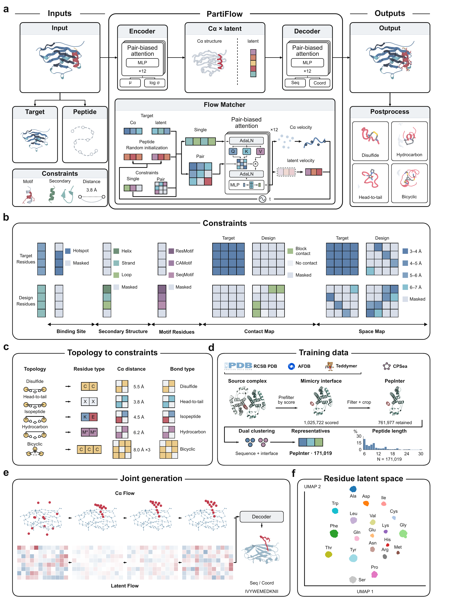

# PartiFlow

PartiFlow generates and refines peptide binders conditioned on receptor structures. One task format covers new binder generation, motif scaffolding, known-sequence docking, inverse folding, and side-chain packing.

[](docs/figures/partiflow-framework.png)

The public commands are `train`, `design`, `validate`, `postprocess`, `cluster`, `check`, and `download`. Both `partiflow` and `python -m partiflow` expose the same interface. Design writes PDB structures.

Create the independent environment from this checkout's `partiflow.yaml`. Before creation, place the licensed PyRosetta 2025.51 CPython 3.11 Linux wheel in `.cache/packages/`; the [installation guide](docs/resources.md) gives its required version and the wheel-install workflow.

```bash
conda env create -f partiflow.yaml
conda activate partiflow-official
partiflow download --list
partiflow check
partiflow design configs/tasks/example.yaml --task klk2_hotspot --out inference/klk2
partiflow validate inference/klk2 --plan
```

The environment recipe includes an editable package installation. Weights and training datasets are provisioned separately. The [resource guide](docs/resources.md) explains local imports, configured downloads, and separate package/configuration and model roots. The complete command and task guides start at [docs/README.md](docs/README.md).

| Task family | Fixed binder information | Generated result |
| --- | --- | --- |
| [denovo](docs/tasks/denovo.md) | Length schedule and optional conditions | Sequence and all-atom structure |
| [motif](docs/tasks/motif.md) | A receptor-bound motif and contig mapping | A scaffold around the retained motif |
| [docking](docs/tasks/docking.md) | Binder sequence | Bound all-atom coordinates |
| [inv_folding](docs/tasks/inverse-folding.md) | Binder CA coordinates | A compatible sequence and side chains |
| [packing](docs/tasks/packing.md) | Binder sequence and CA coordinates | Side-chain coordinates |

`ckpts/partiflow.ckpt` is the general denovo/motif model. `partiflow-aux.ckpt` supports practical docking, inverse folding, and packing. `partiflow-dock.ckpt` is a docking specialist associated with the CPSet-separated training comparison. `partiflow-ss.ckpt` supports secondary-structure and disulfide-conditioned generation. All four use `autoencoder.ckpt`.

AF2 validation and reward accept supported standard protein chemistry and report unsupported chemistry explicitly. Topology-aware postprocessing retains the OpenMM/Rosetta routes; optional quality criteria remain separate from successful relaxation. See [validation](docs/commands/validate.md) and [postprocessing](docs/commands/postprocess.md) for their limits.

See the [performance page](docs/performance.md) for sampling speed, cyclic peptide design and docking benchmarks.
