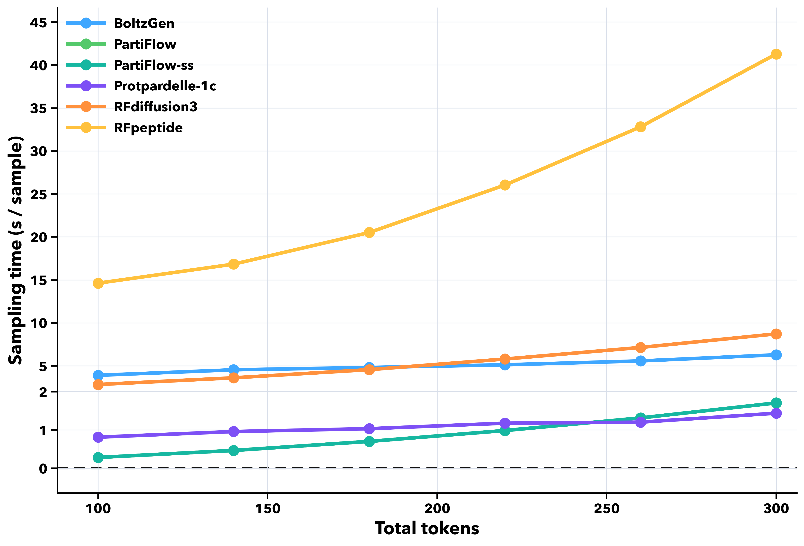
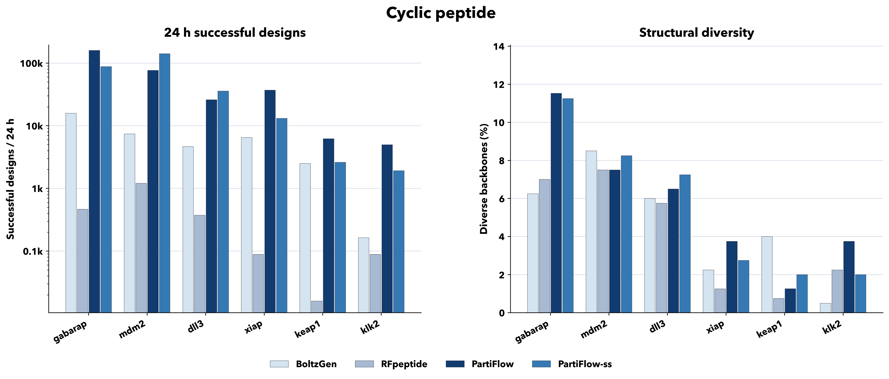
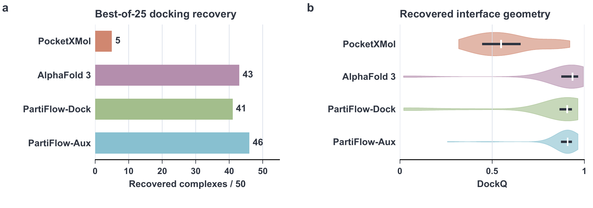

# Original study results

These figures describe the original PartiFlow study and its benchmark settings. They do not report a new benchmark of this command-line release.

## Sampling speed

Sampling time per candidate versus total tokens under the original benchmark settings. AF2 refolding and topology postprocessing are separate stages.

## Cyclic peptide design

The original cyclic peptide benchmark compares projected successful designs over 24 hours on the left and structural diversity on the right. Its AF2 evaluation and generation-budget definitions determine those counts.

## Cyclic peptide docking

The study's Fig. 7 summarizes retrospective docking of known peptide sequences and topologies on CPSet50. Recovery uses the best candidate among 25 and requires receptor-aligned peptide backbone RMSD below 2 Å. DockQ distributions use each complex's minimum-RMSD candidate from that pool; white marks and dark segments show medians and interquartile ranges.
